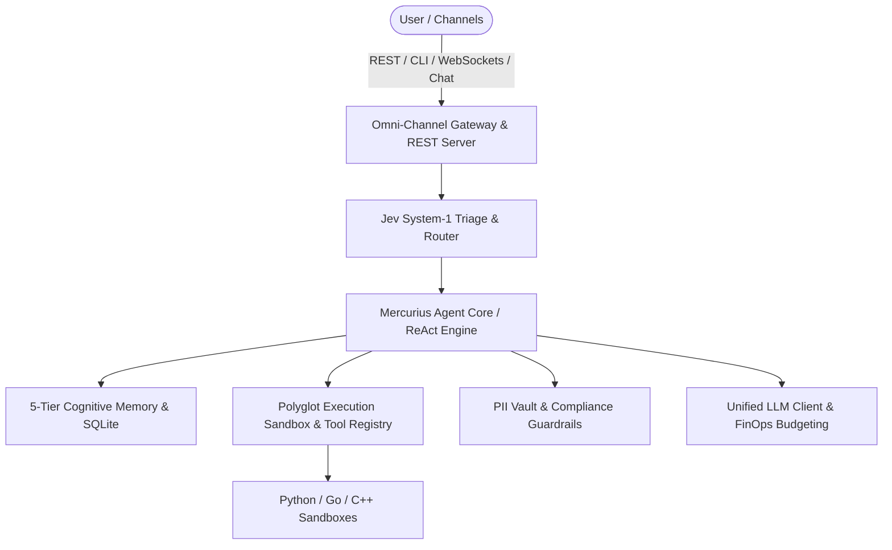
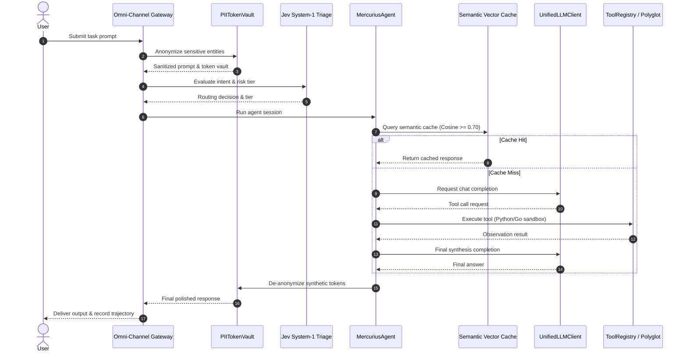
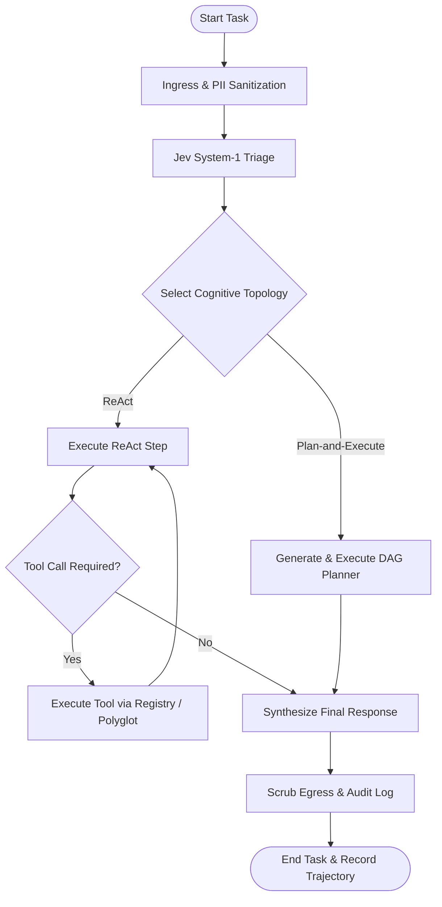
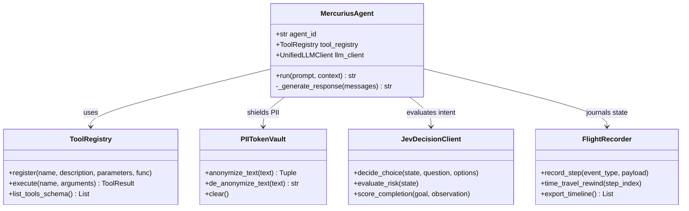

# 💠 Mercurius Autonomous Agentic AI Platform — Architecture Documentation (ARC42)

## 1. Introduction and Goals

### 1.1 Requirements Overview
Mercurius is an enterprise-grade autonomous agentic AI platform developed entirely in pure **Python 3.12+**. It provides robust, secure, and multi-modal execution across local and cloud environments without external Python 3.12+/Python 3.12+ runtimes or fragile dependencies. Key functional and quality attributes include:
- **Autonomous Reasoning & Execution:** Support for 5 core cognitive topologies (Classic ReAct, Plan-and-Execute with HTN Task Networks, Reflexion & Self-Refine, Parallel Coordinator-Worker, and Blackboard architecture).
- **Dual-System AI Architecture:** Kahneman-style separation featuring Jev System-1 non-autoregressive calibrated decision models (<500ms latency) alongside slow System-2 LLM deliberation.
- **Polyglot Sandboxed Execution:** Secure in-process and sandboxed execution across Python 3.12+, Go, C++, and Java.
- **Enterprise Governance & Security:** Zero-Knowledge Ephemeral PII Token Vault, EU AI Act Compliance Risk Engine, HMAC-SHA256 Cryptographic Audit Ledger, and cryptographic Merkle proofs of reasoning.
- **Unified 5-Tier Cognitive Memory:** Working memory, Episodic (SQLite FTS5), Semantic Vector Cache (zero-dependency TF-IDF/cosine similarity), Procedural (GEPA++ skills), and Core memory.
- **Omni-Channel Gateway & Model Context Protocol (MCP July 2026):** Native integration across Telegram, Slack, Discord, WhatsApp, Signal, and Email, alongside dual MCP client/server JSON-RPC 2.0 protocol support.

### 1.2 Quality Goals
1. **Resilience & Fault Tolerance:** Circuit breaker pattern, jittered exponential backoff, dead-letter queues, and dynamic failover.
2. **Deterministic Reproducibility:** Flight recorder event-sourced journaling with time-travel rewinding and timeline branching.
3. **FinOps & Cost Governance:** Departmental budget quotas, soft/hard caps, and autonomous task-level model tier downgrading.
4. **Security & PII Shielding:** Zero-knowledge pseudonymization on ingress and bidirectional de-anonymization on egress.

### 1.3 Quality Attribute Scenarios (Quality Tree)

| Quality Goal | Scenario | Stimulus | Response | Measurement |
| :--- | :--- | :--- | :--- | :--- |
| **Resilience** | Upstream LLM provider outage | LLM API returns 503 Service Unavailable | Circuit breaker transitions to OPEN, triggers exponential backoff or fails over to backup model via Dead-Letter Queue | System recovers without crashing; execution continues within 500ms |
| **Performance** | High-throughput routing | User issues prompt via CLI or REST API | Jev System-1 evaluates intent and selects optimal routing tier | Decision latency < 500ms |
| **Security** | PII data ingress | User inputs text containing corporate IBANs and PII | `PIITokenVault` intercepts and replaces entities with synthetic tokens | Zero raw PII sent to external LLMs |
| **Auditability** | Forensic audit check | Compliance officer requests proof of execution integrity | `ComplianceEngine` verifies HMAC-SHA256 cryptographic audit ledger chain | Zero tampered records detected across sequential event logs |

---

## 2. Architecture Constraints
- **Runtime Environment:** Pure Python 3.12+ core with zero external ML framework bottlenecks or Python 3.12+/Python 3.12+ dependencies.
- **Network Isolation:** Optional air-gapped local execution via Ollama or full cloud integration via Abacus.AI ChatLLM.
- **Storage Architecture:** SQLite-backed persistence for memory, trajectories, budgets, and audit logs.

---

## 3. System Scope and Context

### 3.1 Business Context
Mercurius sits between enterprise users/channels (Telegram, Slack, Web UI, CLI) and underlying AI models (Abacus.AI ChatLLM, OpenAI, Anthropic, local Ollama endpoints), external APIs, and internal secure data vaults.

### 3.2 Technical Context (Mermaid Architecture Diagram)

---

## 4. Solution Strategy
- **Pattern-Oriented Software Architecture (POSA):** Decoupled modular design across 14 specialized subsystem packages (`core`, `tools`, `memory`, `llm`, `security`, `workflows`, `multimodal`, `mcp`, `channels`, `doctor`, `skills`, `jev`, `i18n`, `config`).
- **Defensive Engineering:** Circuit breakers protect against upstream API outages; PII vaults protect sensitive data; Merkle proofs guarantee tamper-evident verification.
- **Self-Evolution (GEPA++):** Post-mortem trajectory reflection, automatic procedural skill synthesis, and DPO dataset export for continuous learning.

---

## 5. Building Block View

### 5.1 White-Box Overall System (`mercurius/`)
- **`mercurius/core/`**: Core agent orchestration (`agent.py`), flight recorder (`flight_recorder.py`), reflexion (`reflexion.py`), pattern executors (`patterns.py`), compactor (`compactor.py`), checkpointing (`checkpoint.py`), and self-learning (`selflearning.py`).
- **`mercurius/tools/`**: Tool registry (`registry.py`), polyglot runner (`polyglot.py`), factory (`factory.py`), healing (`healing.py`), cache (`cache.py`), and web browser (`browser.py`).
- **`mercurius/memory/`**: Semantic vector cache (`semantic.py`), manager (`manager.py`), and autonomous memory (`autonomous.py`).
- **`mercurius/llm/`**: Unified client (`client.py`), router (`router.py`), budget tracker (`budget.py`), and FinOps engine (`finops.py`).
- **`mercurius/security/`**: PII vault (`pii_vault.py`), compliance engine (`compliance.py`), HMAC audit ledger (`merkle_proof.py`), guardrails (`guardrails.py`), and auth (`auth.py`).
- **`mercurius/workflows/`**: StateGraph DAG (`dag.py`), dynamic graph planner (`dynamic_planner.py`), and workflow engine (`engine.py`).
- **`mercurius/multimodal/`**: MediaHub STT/TTS adapter (`media.py`).
- **`mercurius/mcp/`**: Model Context Protocol client/server (`protocol.py`).
- **`mercurius/channels/`**: Omni-channel hub (`hub.py`).
- **`mercurius/doctor/`**: System health diagnostics (`doctor.py`).
- **`mercurius/skills/`**: GEPA++ procedural skill manager (`manager.py`).
- **`mercurius/jev/`**: System-1 decision client (`client.py`).
- **`mercurius/ui/`**: CLI (`cli.py`) and HTTP web server (`server.py`).

---

## 6. Runtime View & UML Diagrams

### 6.1 Sequence Diagram: Prompt Execution & Tool Invocation

### 6.2 Activity Diagram: ReAct & Plan-and-Execute Lifecycle

### 6.3 Class Diagram: Core Architecture Classes

---

## 7. Deployment View

### 7.1 Container Architecture (`deploy/`)
- **Dockerfiles:** Standalone Python container images.
- **Docker Compose (`docker-compose.yml`):** Orchestrates the Mercurius backend, SQLite volumes, and MCP sidecar services.

---

## 8. Cross-Cutting Concepts
- **Logging & Tracing:** JSONL trajectory exports (`data/trajectories/trajectories.jsonl`) and spans.
- **Error Handling:** Dead-letter queues and exponential backoff retry policies.
- **Security & Access Control:** JWT authentication, role-based tool execution, and cryptographic audit ledgers.

---

## 9. Architectural Decisions (ADRs)
- **ADR-01:** Pure Python 3.12+ native implementation for core modules to eliminate heavy ML library bottlenecks and avoid JS/TS compilation errors.
- **ADR-02:** Zero-knowledge PII vaulting for strict GDPR and enterprise privacy compliance.
- **ADR-03:** Dual MCP client/server architecture for extensible enterprise tool orchestration.

---

## 10. Quality Requirements & Test Scenarios
- **100% Test Coverage:** Comprehensive unit tests in `tests/test_mercurius.py` and `tests/test_extended_coverage.py` verifying core resilience, PII vaulting, DAG planning, and finops budgeting.
