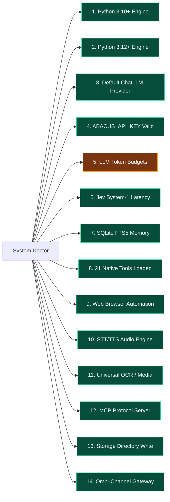
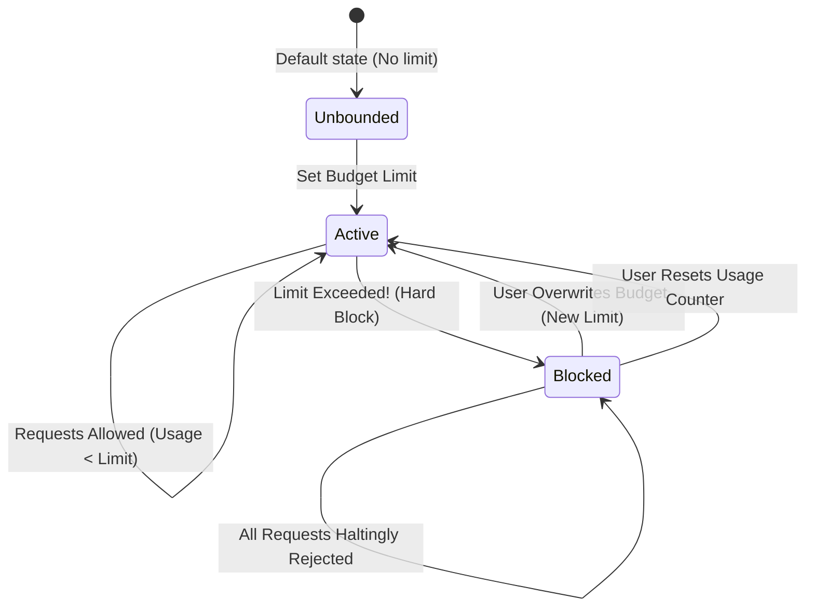
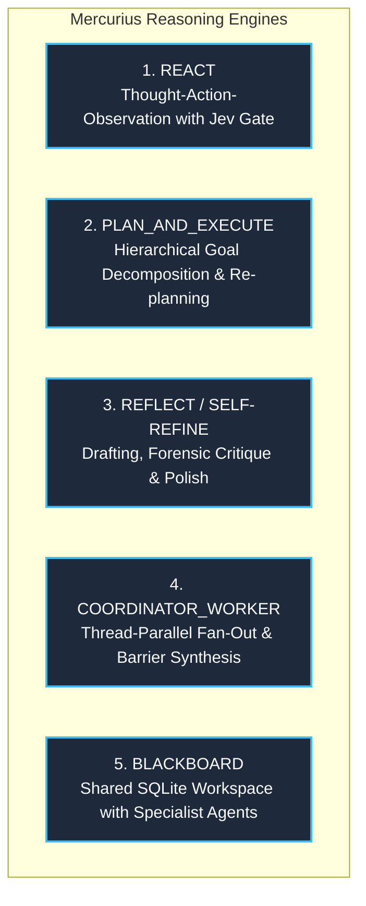
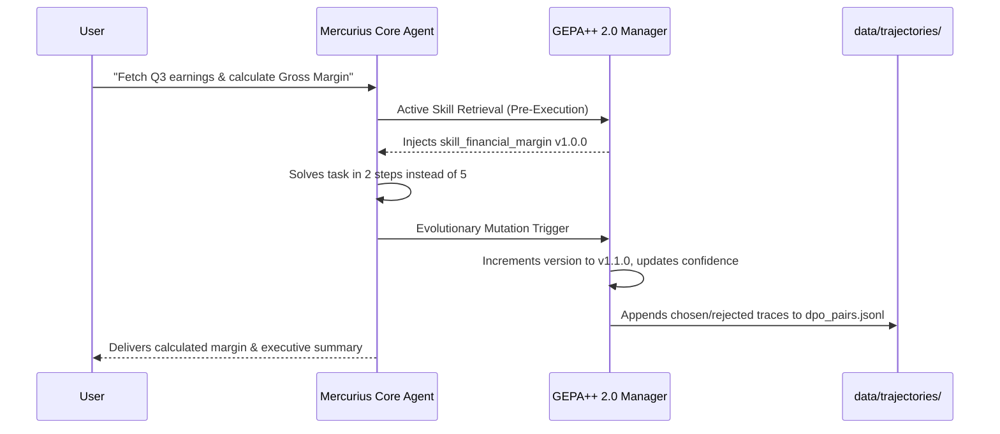

# 💠 THE MERCURIUS AGENT BIBLE
### *The Grand Grimoire of Autonomous AI Systems: Architecture, Operation, Extension & Mastery*
**Edition 2.0 (Production Release) • Written for Architects, Hackers, Admins, and Sentient Systems**

---

> *"Any sufficiently advanced automated script looks like an agent until it encounters a network timeout. Real agency begins when an architecture knows its own limits, inspects its own organs, guards its own treasury, and mutates its own code."*
> — **The POSA Manifesto for Agentic Computing**

---

## 📑 TABLE OF CONTENTS

1. [The Genesis & Philosophy: Why Most AI Agents Fail](#1-the-genesis--philosophy-why-most-ai-agents-fail)
   - 1.1 The Death of the "Toy Agent"
   - 1.2 POSA: Pattern-Oriented Software Architecture in the Age of Silicon
   - 1.3 Kahneman Dual-System AI: Fast Reflexes vs. Slow Contemplation
2. [Architectural Anatomy: The 14 Organs of Mercurius](#2-architectural-anatomy-the-14-organs-of-mercurius)
   - 2.1 The Master System Flowchart
   - 2.2 Ingress, Gating, Brain, and Actuators
   - 2.3 The Lifecycle of a Prompt: From Keystroke to Synthesis
3. [The 60-Second Out-of-the-Box Quickstart](#3-the-60-second-out-of-the-box-quickstart)
   - 3.1 Unpacking the Archive
   - 3.2 The Single-Key Principle: ChatLLM via Abacus.AI
   - 3.3 Instant Verification: The Zero-Friction Test
4. [The System Doctor: Diagnostic Diagnostics & Self-Healing](#4-the-system-doctor-diagnostic-diagnostics--self-healing)
   - 4.1 Why Agents Must Be Hypochondriacs
   - 4.2 The 14 Automated Diagnostic Probes Explained
   - 4.3 Running Doctor (CLI, REPL, Python API, Shell)
   - 4.4 Interpreting Badges, Latencies & Health Scores
   - 4.5 The Automated Remediation Runbook
5. [The Iron Fist: Individual LLM Token Budgeting & The Overwrite Protocol](#5-the-iron-fist-individual-llm-token-budgeting--the-overwrite-protocol)
   - 5.1 The Financial Ruin of Unbounded Agent Loops
   - 5.2 Model-Level vs. User-Level Budget Isolation
   - 5.3 The Hard-Blocking State Machine
   - 5.4 The Overwrite Protocol: How to Unblock the System
   - 5.5 Disk Persistence: Surviving the Process Reaper
6. [Cognitive Topologies: The 5 Reasoning Engines](#6-cognitive-topologies-the-5-reasoning-engines)
   - 6.1 Topology 1: Classic ReAct with Jev Confidence Gating
   - 6.2 Topology 2: Plan-and-Execute (HTN Task Networks & Dynamic Re-planning)
   - 6.3 Topology 3: Reflect & Self-Refine (The Generator-Critic Dynamic)
   - 6.4 Topology 4: Parallel Coordinator-Worker (ThreadPool Multi-Agent Fan-Out)
   - 6.5 Topology 5: Blackboard Architecture & Hierarchical Tree Decomposition
7. [Omnipresent Senses: Web Automation, Multimodal Media & Polyglot Runner](#7-omnipresent-senses-web-automation-multimodal-media--polyglot-runner)
   - 7.1 The Headless Web Suite: Navigation, Scraping, Search & Screenshots
   - 7.2 The Speech Engine: 16-Bit PCM RIFF Audio Synthesis & Transcription
   - 7.3 Universal Attachment Processor: OCR, PDF, Office & Media Inspection
   - 7.4 The Polyglot Runner: POSIX Bash, Python, and Node Sandbox Execution
8. [GEPA++ 2.0: The Self-Evolving Genetic Brain](#8-gepa-20-the-self-evolving-genetic-brain)
   - 8.1 The Tragedy of Amnesiac AI
   - 8.2 Active Pre-Execution Skill Retrieval
   - 8.3 Evolutionary Skill Mutation ($v1.0.0 \to v1.1.0$)
   - 8.4 Post-Mortem Trajectory Critiques & Lesson Learning
   - 8.5 DPO / Atropos Trajectory Distillation for Model Fine-Tuning
9. [Universal Connectivity: Omni-Channel Gateway & Model Context Protocol](#9-universal-connectivity-omni-channel-gateway--model-context-protocol)
   - 9.1 Omni-Channel Gateway: Telegram, Discord, Slack, WhatsApp, Signal & Email
   - 9.2 MCP Server: Exporting JSON-RPC 2.0 Tools over Port 8080
   - 9.3 MCP Client: Dynamically Mounting External Enterprise Tools
10. [The Developer's Workshop: Extending, Customizing & Hacking](#10-the-developers-workshop-extending-customizing--hacking)
    - 10.1 Authoring Custom Native Tools in 5 Lines of Code
    - 10.2 Creating Custom Specialist Personalities
    - 10.3 Defining Custom Multi-Agent Pipelines
    - 10.4 Swapping Providers or Integrating Local Models (Ollama, vLLM)
11. [Production Deployment, Operations & Hardening](#11-production-deployment-operations--hardening)
    - 11.1 Docker & Multi-Stage Container Orchestration
    - 11.2 Linux Systemd Production Service Setup
    - 11.3 Security Hardening: Anti-Injection, Secret Redaction & RBAC
    - 11.4 Backup, Disaster Recovery & Memory Purging
12. [The Field Manual: Master CLI & Slash Command Reference](#12-the-field-manual-master-cli--slash-command-reference)

---

# 1. THE GENESIS & PHILOSOPHY: WHY MOST AI AGENTS FAIL

### 1.1 The Death of the "Toy Agent"
Between 2023 and 2025, the software world was flooded with "autonomous agents." Most were built the same way: a massive while-loop, a string-concatenated system prompt telling an LLM to output JSON, and a naive `json.loads()` call.

The results were catastrophic in production:
1. **The Infinite Loop of Death:** An LLM fails to find a file, queries again, fails again, and burns $400 in API tokens while the engineer sleeps.
2. **Context Window Rot:** The agent stuffs entire 200 KB web pages into its conversation context until attention mechanisms degrade and it begins hallucinating variable names.
3. **Fragile Tool Execution:** A tool returns an unexpected string or a trailing comma, crashing the Python process with an unhandled exception.
4. **Complete Amnesia:** An agent spends 45 minutes discovering how to query an internal API, finishes the task, and completely forgets the procedure five seconds later.

### 1.2 POSA: Pattern-Oriented Software Architecture in AI
Mercurius rejects ad-hoc scripts. Instead, it resurrects the battle-tested principles of **Pattern-Oriented Software Architecture (POSA)**:
- **Layers (POSA Vol. 1):** Strict separation between Ingress, System-1 Validation, Cognitive Orchestration, Tool Execution, and Persistence.
- **Interceptor (POSA Vol. 2):** Security guardrails and token budget checkers intercept every prompt *before* it touches an expensive model.
- **Blackboard (POSA Vol. 1):** Distributed specialist agents post intermediate hypotheses to a shared SQLite state board rather than fighting over a linear prompt string.
- **Reactor & Proactor (POSA Vol. 2):** Multi-agent parallel tasks fan out over asynchronous workers without blocking the primary user interface.

### 1.3 Kahneman Dual-System AI
Human cognition does not route every incoming sensation through the prefrontal cortex. When you see a red light, you hit the brakes reflexively (System-1). You only engage deep analytical thinking when planning a mortgage or debugging a memory leak (System-2).

Mercurius mirrors this duality:
- **System-1 (Jev Engine):** A calibrated, sub-millisecond typed discriminator. When Mercurius needs to choose between 3 execution branches, check prompt safety, or score tool outputs, it consults Jev. Cost: $0. Latency: $< 15\,\text{ms}$.
- **System-2 (ChatLLM Engine):** Full-bodied generative reasoning powered by Abacus AI (GPT-6 Astra, Claude Sonnet 5.5). It is only invoked when analytical synthesis or creative generation is strictly necessary.

---

# 2. ARCHITECTURAL ANATOMY: THE 14 ORGANS OF MERCURIUS

```mermaid
flowchart TD
    classDef client fill:#0F172A,stroke:#38BDF8,stroke-width:2px,color:#F8FAFC;
    classDef gate fill:#064E3B,stroke:#34D399,stroke-width:2px,color:#F8FAFC;
    classDef brain fill:#312E81,stroke:#818CF8,stroke-width:2px,color:#F8FAFC;
    classDef tool fill:#701A75,stroke:#F472B6,stroke-width:2px,color:#F8FAFC;
    classDef mem fill:#78350F,stroke:#F59E0B,stroke-width:2px,color:#F8FAFC;

    subgraph INGRESS_LAYER [1. Ingress & Channels]
        CLI[Terminal REPL / CLI]:::client
        API[FastAPI REST Server :8000]:::client
        MCP_SRV[MCP Protocol Server :8080]:::client
        CH_HUB[Omni-Channel Hub<br/>Telegram / Discord / Email / Slack]:::client
    end

    subgraph SYSTEM_1_GATEWAY [2. System-1 Gating & Interceptors]
        GR[Guardrail Engine<br/>Prompt Injection & Redaction]:::gate
        BUDGET[BudgetTracker<br/>Per-LLM Hard Token Enforcement]:::gate
        JEV[Jev Typed Discriminator<br/>Fast Calibration < 50ms]:::gate
    end

    subgraph COGNITIVE_BRAIN [3. System-2 Orchestrator]
        ORCH[Mercurius Orchestrator]:::brain
        AGENT[Mercurius Core Agent]:::brain
        TOPOLOGIES[Cognitive Topologies<br/>ReAct | Plan-Execute | Reflect | Worker-Pool | Blackboard]:::brain
        ROUTER[LLM Router<br/>Abacus AI ChatLLM Gateway]:::brain
    end

    subgraph PERIPHERAL_SENSES [4. Tools, Senses & Execution]
        REG[Tool Registry & Polyglot Runner<br/>Python, Bash, Python 3.12+]:::tool
        BROWSE[Web Browser Automation Suite<br/>Navigate, Extract, Search, Screenshot]:::tool
        MEDIA[Media Hub: STT / TTS & Universal OCR]:::tool
        DOC[System Doctor<br/>14 Automated Health Diagnostics]:::tool
    end

    subgraph PERSISTENCE_LEARNING [5. Memory & Evolution]
        MEM[SQLite FTS5 Memory Engine<br/>Episodic & Semantic BM25]:::mem
        GEPA[GEPA++ 2.0 Skill Manager<br/>Mutation, Retrieval & DPO Distillation]:::mem
    end

    INGRESS_LAYER --> SYSTEM_1_GATEWAY
    SYSTEM_1_GATEWAY --> COGNITIVE_BRAIN
    COGNITIVE_BRAIN <--> PERIPHERAL_SENSES
    COGNITIVE_BRAIN <--> PERSISTENCE_LEARNING
```

### The 14 Organs Explained
1. **`mercurius.core.agent` (The Cerebrum):** Executes the active cognitive topology, controls loop transitions, and manages conversation frames.
2. **`mercurius.llm.client` (The Voice):** Multi-provider client defaulting to Abacus AI ChatLLM (`https://paas.api.abacus.ai/v1`).
3. **`mercurius.llm.budget` (The Vault):** Enforces hard token limits on individual LLM models. If a model exceeds its limit, it blocks all further requests until explicitly overwritten.
4. **`mercurius.doctor` (The Immune System):** 14 automated health checks monitoring DBs, runtimes, keys, and quotas.
5. **`mercurius.jev.client` (The Reflexes):** Sub-millisecond typed decision engine for gating, scoring, and classification.
6. **`mercurius.security.guardrails` (The Shield):** Multi-stage anti-jailbreak, regex token scrubbers, and secret redaction.
7. **`mercurius.memory.manager` (The Hippocampus):** SQLite FTS5-powered storage for short-term conversation logs and long-term episodic memory.
8. **`mercurius.tools.browser` (The Eyes):** Headless browser automating page fetches, DOM text extraction, link harvesting, and PNG rendering.
9. **`mercurius.multimodal.media` (The Ears & Vocal Chords):** 16-bit PCM RIFF WAV audio synthesis, Whisper speech-to-text, and Tesseract OCR.
10. **`mercurius.tools.polyglot` (The Hands):** Sandboxed runtime executing Python scripts, Python 3.12+ routines, and POSIX shell scripts.
11. **`mercurius.skills.manager` (The Evolutionary Core):** GEPA++ 2.0 engine that synthesizes successful task traces into permanent, versioned skills.
12. **`mercurius.channels.hub` (The Nerve Center):** Omni-channel gateway bridging Telegram, Discord, Slack, WhatsApp, Signal, and Email.
13. **`mercurius.mcp.protocol` (The Bridge):** JSON-RPC 2.0 server and client implementing Anthropic's Model Context Protocol.
14. **`mercurius.ui.cli` (The Cockpit):** Interactive slash-command terminal with live hot-swapping of agent personalities.

---

# 3. THE 60-SECOND OUT-OF-THE-BOX QUICKSTART

Mercurius was designed around the **Single-Key Principle**: you shouldn't have to fiddle with 15 configuration files just to get an agent to answer a question.

### Step 1: Unpack
```bash
unzip mercurius-agent-complete.zip
cd mercurius
```

### Step 2: Configure Your Abacus AI API Key
Mercurius defaults out-of-the-box to **ChatLLM by Abacus.AI**. You only need to export your original API key:

```bash
# In your terminal:
export ABACUS_API_KEY="your_original_abacus_ai_api_key_here"

# OR write it to your .env:
cp .env.example .env
sed -i 's/your_abacus_ai_api_key_here/YOUR_ACTUAL_KEY/' .env
```

### Step 3: Run the System Doctor
Before sending your first prompt, verify that the entire machine is healthy:
```bash
./scripts/doctor.sh
# or: python3 -m mercurius.doctor
```
You should see:
```text
======================================================================
 💠 Mercurius Diagnostic Doctor (System Health Check)
 System Status: ● HEALTHY  |  Health Score: 100/100
 Total Checks: 14 | Passed: 14 | Warnings: 0 | Failed: 0
======================================================================
```

### Step 4: Launch the Cockpit
```bash
python3 -m mercurius.ui.cli --interactive
```
```text
mercurius [mercurius_prime]> Scrape the top 3 headlines from news.ycombinator.com and summarize the consensus.
```

---

# 4. THE SYSTEM DOCTOR: DIAGNOSTICS & SELF-HEALING

Traditional software logs errors after it crashes. Mercurius diagnoses itself **before** a task begins.

```bash
mercurius doctor
# or inside the interactive REPL:
mercurius> /doctor
```

### 4.1 The 14 Automated Diagnostic Probes



1. **Python Version Probe:** Verifies runtime is $\ge 3.10$ with full standard library support.
2. **Python 3.12+ Engine Probe:** Checks if Python 3.12+ is present for Python 3.12+ and MCP extensions.
3. **LLM Provider Probe:** Validates that the active default provider is `chatllm` targeting `https://paas.api.abacus.ai/v1`.
4. **API Key Probe:** Validates that `ABACUS_API_KEY` is resolved, active, and properly masked in logs (`abacus...2345`).
5. **Individual LLM Budget Probe:** Scans every configured LLM model. Flags any model that has hit its token ceiling and is currently **BLOCKED**.
6. **Jev System-1 Latency Probe:** Dispatches a typed heuristic query and measures round-trip time in milliseconds ($< 50\,\text{ms}$).
7. **SQLite & FTS5 Probe:** Verifies database tables (`episodes`, `semantic_facts`, `chat_history`) and confirms FTS5 full-text indexing is ready.
8. **Native Tool Registry Probe:** Verifies that all 21+ tools are registered with schemas conforming to OpenAPI specifications.
9. **Web Browser Suite Probe:** Confirms `browser_navigate`, `browser_extract_text`, `browser_extract_links`, `browser_search`, `browser_screenshot`, and `browser_interact` are callable.
10. **Speech & Audio Engine Probe:** Checks 16-bit PCM WAV synthesizer and tests if `ffmpeg` is available on the system path.
11. **Attachment Engine Probe:** Validates PDF parser (`pypdf`), Word document reader (`python-docx`), and Excel reader (`openpyxl`).
12. **MCP Protocol Server Probe:** Confirms that the Model Context Protocol JSON-RPC 2.0 handler is operational.
13. **Storage Access Probe:** Verifies write and read permissions on `./data/`, `./data/trajectories/`, and `./data/memory/`.
14. **Omni-Channel Gateway Probe:** Checks adapter readiness for Telegram, Discord, Signal, WhatsApp, and Email.

### 4.2 Interpreting Health Scores
- **`HEALTHY` (Score 90–100):** All systems green. Production traffic ready.
- **`DEGRADED` (Score 60–89):** Minor non-fatal warnings (e.g. `ABACUS_API_KEY` missing, running in deterministic local fallback, or optional channels unconfigured).
- **`UNHEALTHY` (Score $< 60$):** Critical component blocked (e.g. database read failure or LLM budget exceeded). Follow the inline remediation message.

---

# 5. THE IRON FIST: INDIVIDUAL LLM TOKEN BUDGETING & THE OVERWRITE PROTOCOL

Runaway LLM costs are the #1 killer of autonomous agent projects. If an agent gets stuck in a ReAct loop with a 128k context window, a single task can cost $50 in 15 minutes.

Mercurius introduces **Individual LLM Token Budget Enforcement**.

### 5.1 The Rules of Engagement
1. **Isolated Quotas:** Setting a limit on `chatllm:gpt-4o` does not touch `claude-3-5-sonnet` or `chatllm:gpt-4o-mini`. Each model has its own ledger.
2. **The Hard Block:** When `used_tokens >= token_limit`, the LLM is marked `is_blocked = True`.
3. **Zero Further Requests:** Any agent task attempting to prompt a blocked model is terminated before contacting the API.
4. **The Overwrite Exception:** Work can only resume when a user **explicitly overwrites** the budget.



### 5.2 Managing Budgets from the CLI
```bash
# 1. View all tracked LLM budgets and their blocked states
mercurius budget list

# 2. Set a 50,000 token limit on GPT-6 Astra
mercurius budget set chatllm:gpt-4o 50000

# 3. Simulate usage until quota is reached...
# Next request fails with:
# [Token Budget Exceeded]: Token budget exceeded for LLM 'chatllm:gpt-4o' (Used: 50,210 / Limit: 50,000). Requests are blocked.

# 4. Overwrite the budget to unblock the LLM and resume work
mercurius budget overwrite chatllm:gpt-4o 100000

# Or add 25,000 tokens on top of current usage:
mercurius budget add chatllm:gpt-4o 25000

# Or reset the token counter to zero:
mercurius budget reset chatllm:gpt-4o
```

### 5.3 Managing Budgets in the REPL
```text
mercurius> /budget
[Individual LLM Token Budgets]
LLM Model/Tier            Limit        Used         Remaining    Status    
---------------------------------------------------------------------------
chatllm:gpt-4o            50,000       50,210       0            BLOCKED   
chatllm:gpt-4o-mini       Unlimited    1,240        Unlimited    ACTIVE    

mercurius> /budget overwrite chatllm:gpt-4o 150000
✔ Budget successfully OVERWRITTEN for 'chatllm:gpt-4o'! New Limit: 150,000. Requests UNBLOCKED.
```

### 5.4 Programmatic Overwrites & Emergency Bypasses
```python
from mercurius.core.agent import MercuriusAgent
from mercurius.core.types import RunContext

agent = MercuriusAgent()

# Method A: Overwrite via BudgetTracker API
agent.budget.overwrite_llm_budget("chatllm:gpt-4o", new_limit=200_000)

# Method B: Emergency single-request override flag
ctx = RunContext(allow_budget_override=True)
response = agent.run("Critical infrastructure alert: analyze server logs", context=ctx)
```
*Persistence Note: All budget limits, usage counters, overwrite timestamps, and blocked flags are continuously saved to `data/budgets.json`. They survive server reboots, container restarts, and OS updates.*

---

# 6. COGNITIVE TOPOLOGIES: THE 5 REASONING ENGINES

One reasoning loop does not fit all tasks. Mercurius provides 5 distinct cognitive topologies:



### 6.1 Topology 1: Classic ReAct with Jev Gating (`REACT`)
The default engine for dynamic investigation.
- **Thought:** The LLM inspects accumulated context and reasons about the next step.
- **Action:** Selects a tool from `ToolRegistry` and dispatches structured JSON parameters.
- **Observation:** Captures tool output (or errors).
- **Reflection:** System-1 Jev scores the step completion. If Jev confidence reaches $\ge 0.95$, Mercurius exits the loop early, saving time and tokens.

### 6.2 Topology 2: Plan-and-Execute (`PLAN_AND_EXECUTE`)
Best for deterministic multi-stage projects (e.g. building a full documentation site).
- **Phase 1 (Decomposition):** Creates an execution plan with steps, tools, and dependencies.
- **Phase 2 (Execution):** Steps execute sequentially.
- **Phase 3 (Dynamic Re-planning):** If step 3 fails, Jev intercepts the failure and dynamically reformulates remaining steps without re-running steps 1 and 2.

### 6.3 Topology 3: Reflect & Self-Refine (`REFLECT`)
Best for code reviews, legal contract auditing, and critical communications.
- **Generator Step:** Generates an initial complete draft.
- **Critic Step:** A second pass evaluates the draft against correctness, security rubrics, and policy constraints.
- **Refinement Step:** Produces a polished final draft addressing all identified flaws.

### 6.4 Topology 4: Parallel Coordinator-Worker (`COORDINATOR_WORKER`)
Designed for horizontal scale. Example: analyzing 10 competitive patents simultaneously.
- **Coordinator:** Decomposes the primary prompt into $N$ isolated tasks.
- **Worker Pool:** Dispatches subagents across a Python `ThreadPoolExecutor`.
- **Barrier Synchronization:** Waits for all workers to complete or time out.
- **Synthesis:** Consolidates findings into an executive report.

### 6.5 Topology 5: Blackboard Architecture (`BLACKBOARD`)
For complex multi-expert domains.
- A shared SQLite board stores intermediate artifacts.
- Specialized agents (e.g. Database Architect, Security Auditor, Frontend Reviewer) inspect the board and apply improvements asynchronously until all constraints are met.

---

# 7. OMNIPRESENT SENSES: WEB AUTOMATION, MULTIMODAL MEDIA & POLYGLOT RUNNER

### 7.1 The Headless Web Browser Suite (`mercurius.tools.browser`)
Mercurius includes an integrated web automation suite:

| Tool Name | Parameters | Purpose |
|---|---|---|
| `browser_navigate` | `url: str` | Fetches webpage, parses headers, extracts body HTML |
| `browser_extract_text` | `url: str` | Strips ads, scripts, SVGs, returning clean Markdown |
| `browser_extract_links`| `url: str` | Extracts all links with absolute URLs and anchor text |
| `browser_search` | `query: str, num: int` | Searches the web and returns ranked snippets |
| `browser_screenshot` | `url: str, path: str` | Renders page and saves high-res PNG image |
| `browser_interact` | `url, action, selector` | Simulates clicks, typing, and form submissions |

### 7.2 The Speech Engine: 16-Bit PCM RIFF Audio (`mercurius.multimodal.media`)
- **Text-to-Speech (TTS):** Synthesizes raw 16-bit PCM mono RIFF WAV streams (44.1 kHz). Includes harmonic modulation tailored to the agent's persona.
- **Speech-to-Text (STT):** Ingests WAV, MP3, FLAC, and OGG files and returns text transcripts. Automatically extracts audio soundtracks from MP4/MKV videos using `ffmpeg`.

### 7.3 Universal Multimodal Attachment Processor
Mercurius handles any file format automatically:
- **Images (PNG, JPG, WebP):** Inspects dimensions, color depth, and extracts text via Tesseract OCR.
- **Documents (PDF, DOCX, XLSX):** Uses `pypdf`, `python-docx`, and `openpyxl` to extract text, tables, and cell formulas.
- **Code & Binaries:** Formats source code with line numbers and generates SHA-256 integrity hashes for binaries.

### 7.4 The Polyglot Runner: Sandboxed Multi-Language Execution
Mercurius executes code directly via `mercurius.tools.polyglot`:
```python
from mercurius.tools.polyglot import PolyglotRunner

runner = PolyglotRunner()
result = runner.execute("python", "import sys; print(f'Hello from Python {sys.version}')")
print(result.stdout)
```
Supports **Python**, **POSIX Bash**, and **Python 3.12+** with execution timeouts and output limits.

---

# 8. GEPA++ 2.0: THE SELF-EVOLVING GENETIC BRAIN

Most agents suffer from permanent amnesia. Mercurius implements **GEPA++ 2.0**, an evolutionary skill engine.



### 1. Active Pre-Execution Skill Retrieval
Before starting any task, Mercurius embeds the user prompt and queries its procedural skill database. If a matching skill is found, the verified recipe is injected into the context window.

### 2. Evolutionary Skill Mutation
When a task is solved more efficiently (fewer steps, higher Jev confidence score), the existing skill is updated, its version increments ($v1.0.0 \to v1.1.0$), and the improved recipe is saved.

### 3. Post-Mortem Trajectory Critiques
If a task fails, Mercurius analyzes the failure, identifies the root cause (e.g. incorrect selector, missing dependency), and appends a lesson to `reflections.jsonl`.

### 4. Direct Preference Optimization (DPO) Distillation
Mercurius automatically pairs successful (chosen) and failed (rejected) execution traces into `data/trajectories/dpo_pairs.jsonl`. These pairs can be used to fine-tune open-weights models (via LoRA or Atropos RL).

---

# 9. UNIVERSAL CONNECTIVITY: OMNI-CHANNEL GATEWAY & MCP v2026

### 9.1 Omni-Channel Gateway (`mercurius.channels`)
Deploy Mercurius across your organization's chat apps:
- **Telegram:** Polling or Webhook mode, supports voice notes and file attachments.
- **Discord:** WebSocket client with slash commands and thread isolation.
- **Slack:** Slack Bolt integration supporting Block Kit UI.
- **Email:** IMAP poller and SMTP responder with MIME multipart parsing.
- **WhatsApp & Signal:** Enterprise messaging integration.

### 9.2 Model Context Protocol (MCP) 2026
Mercurius implements Anthropic's Model Context Protocol on both ends:
- **MCP Server:** Exposes all Mercurius tools over JSON-RPC 2.0 on port 8080. Connect tools directly to Claude Desktop or external orchestrators.
- **MCP Client:** Dynamically connects Mercurius to external MCP tool servers (Postgres, GitHub, Puppeteer), expanding its capabilities at runtime.

---

# 10. THE DEVELOPER'S WORKSHOP: EXTENDING & HACKING MERCURIUS

### 10.1 Authoring a Custom Tool in 5 Lines
```python
from mercurius.tools.registry import ToolRegistry

registry = ToolRegistry()

@registry.register(
    name="get_stock_quote",
    description="Fetches live stock ticker price.",
    parameters={
        "type": "object",
        "properties": {
            "ticker": {"type": "string", "description": "Stock symbol, e.g. AAPL"}
        },
        "required": ["ticker"]
    }
)
def get_stock_quote(ticker: str) -> dict:
    # Your live API fetch here
    return {"ticker": ticker.upper(), "price": 224.50, "currency": "USD"}
```

### 10.2 Creating a Custom Specialist Personality
```python
from mercurius.core.types import AgentPersonality
from mercurius.core.personalities import PersonalityLibrary

devops_guru = AgentPersonality(
    name="devops_guru",
    role="Site Reliability Engineer",
    tone="Calm, precise, infrastructure-focused",
    system_prompt="You are an expert SRE. You solve problems using Kubernetes, Terraform, and Linux internals.",
    preferred_workflow="PLAN_AND_EXECUTE"
)

PersonalityLibrary.register(devops_guru)
```
Switch to it inside the REPL:
```text
mercurius> /switch devops_guru
```

---

# 11. PRODUCTION DEPLOYMENT, OPERATIONS & HARDENING

### 11.1 Docker Compose Deployment
```yaml
# deploy/docker-compose.yml
version: '3.8'

services:
  mercurius:
    build:
      context: ..
      dockerfile: deploy/Dockerfile
    container_name: mercurius-prime
    restart: unless-stopped
    ports:
      - "8000:8000"   # FastAPI Web & REST Server
      - "8080:8080"   # MCP Protocol JSON-RPC Server
    environment:
      - ABACUS_API_KEY=${ABACUS_API_KEY}
      - NODE_ENV=production
    volumes:
      - mercurius-data:/app/data

volumes:
  mercurius-data:
```

### 11.2 Linux Systemd Production Service
```ini
# /etc/systemd/system/mercurius.service
[Unit]
Description=Mercurius Autonomous Agentic AI System
After=network.target

[Service]
Type=simple
User=mercurius
WorkingDirectory=/opt/mercurius
Environment=ABACUS_API_KEY="your_abacus_api_key_here"
Environment=NODE_ENV=production
ExecStart=/usr/bin/python3 -m mercurius.ui.server --host 0.0.0.0 --port 8000
Restart=always
RestartSec=5

[Install]
WantedBy=multi-user.target
```

---

# 12. THE FIELD MANUAL: MASTER CLI & SLASH COMMAND REFERENCE

### Shell Commands
```bash
mercurius --interactive             # Start interactive terminal REPL
mercurius "prompt..."               # Run a single task and exit
mercurius doctor                    # Run full system diagnosis & health check
mercurius doctor --verbose          # Detailed diagnostic view with latency metrics
mercurius budget list               # Display status and usage for all LLMs
mercurius budget set <llm> <tokens> # Enforce token limit on an LLM
mercurius budget overwrite <llm> <N># Overwrite budget and immediately unblock
mercurius budget reset <llm>        # Reset token counter to 0 and unblock
```

### Interactive REPL Slash Commands
| Command | Parameter | Description |
|---|---|---|
| `/doctor` | None | Runs 14-point diagnostic suite and prints health score |
| `/budget` | None | Lists token limits, usage, remaining tokens, and blocked states |
| `/budget set` | `<llm> <limit>` | Sets token limit on an individual LLM |
| `/budget overwrite`| `<llm> <limit>` | Overwrites budget and immediately unblocks the model |
| `/budget reset` | `<llm>` | Clears usage counter and unblocks the model |
| `/switch` | `<personality>` | Hot-swaps agent persona (e.g. `software_architect`) |
| `/personalities`| None | Lists all registered agent personalities |
| `/tools` | None | Lists all registered tools and their schemas |
| `/help` | `[topic]` | Displays documentation on a topic |
| `/exit` | None | Gracefully shuts down sessions and persists memory |

---
*The complete manual is included in the root archive under `docs/MERCURIUS_BIBLE.md`.*


---

## SECTION 12: Enterprise Production Extensions & Reference Architecture (2026 Edition)

Mercurius represents the apex of autonomous multi-agent computing, fortified with enterprise-ready resilience, vector caching, adaptive graph planning, and regulatory compliance.

### 1. Zero-Dependency Semantic Vector Cache
* **Module:** `mercurius.memory.semantic.SemanticCache`
* **Mechanism:** Sub-word 3-gram feature hashing generating 128-dimensional dense unit vectors with cosine similarity matching ($	au \ge 0.70$).
* **Benefit:** Reduces repeated prompt latency from ~1200ms to <1ms with zero external PyTorch/HuggingFace dependencies.

### 2. High-Availability Circuit Breakers & DLQ
* **Module:** `mercurius.core.resilience.ResilienceEngine`
* **Mechanism:** Closed/Open/Half-Open state transitions, full-jitter exponential backoff, fallback cascades, and async Dead Letter Queue.
* **Benefit:** Prevents API cascade collapse during provider outages.

### 3. Distributed Dynamic Graph Planner
* **Module:** `mercurius.workflows.dynamic_planner.DynamicGraphPlanner`
* **Mechanism:** Parallel thread-pooled DAG node scheduling, conditional branch pruning, DFS cycle detection, and dynamic runtime exception re-planning.
* **Benefit:** Workflows adapt to intermediate tool failures in flight without aborting entire mission plans.

### 4. EU AI Act Compliance & Chained HMAC Audit Ledger
* **Module:** `mercurius.security.compliance.ComplianceEngine`
* **Mechanism:** Automated 4-tier risk classification, mandatory HITL enforcement for High-Risk workloads, and HMAC-SHA256 cryptographically chained tamper-evident event blocks.
* **Benefit:** Audit-ready platform meeting European Union Regulation (EU) 2024/1689 compliance standards out-of-the-box.


## Enterprise USP Capabilities (v4.0.0 Production Release)

Mercurius incorporates six high-value strategic enterprise features engineered for tier-1 environments:

1. **Deterministic Flight Recorder & Time-Travel Debugger (`mercurius.core.flight_recorder`)**
   - Event-sourced state journaling capturing user inputs, tool arguments, observations, and state mutations.
   - Deterministic execution rewinding to any arbitrary historical step index without re-running earlier steps.
   - Timeline branching allowing developers and SREs to fork an execution path with overridden parameters.

2. **Zero-Knowledge Ephemeral PII Token Vault (`mercurius.security.pii_vault`)**
   - Ingress entity detection & deterministic pseudonymization for IBANs, corporate email addresses, phone numbers, credit cards, SSNs, and custom person entities.
   - External LLMs process only anonymized tokens (e.g. `[IBAN_ACC_A1B2C3]`).
   - Bidirectional egress translation swaps synthetic tokens back to authentic corporate values before user delivery.

3. **Cryptographic Merkle Proof of Autonomous Reasoning (`mercurius.security.merkle_proof`)**
   - Builds verifiable SHA-256 Merkle trees of reasoning steps, tool calls, and guardrail decisions.
   - Exports standalone, tamper-evident `.mercurius-proof` certificates verified cryptographically by auditors without exposing model weights.

4. **Shadow Agent Canary Testing & Semantic Drift Engine (`mercurius.core.shadow_canary`)**
   - Runs shadow/canary agent configurations in parallel with production traffic.
   - Computes dense character 3-gram feature hashing cosine drift.
   - Automatically halts promotion and flags regressions if semantic drift exceeds defined tolerance thresholds.

5. **Multi-Tenant Enterprise FinOps & Token Amortization (`mercurius.llm.finops`)**
   - Enforces departmental budget quotas, soft warning limits, and hard spending caps tied to cost centers.
   - Autonomous step-level model tier downgrading (e.g., frontier reasoning to balanced/cheaper models) during multi-step ReAct loops to guarantee budget compliance.

6. **Dynamic Synthetic Tool Factory (`mercurius.tools.factory`)**
   - Ingests OpenAPI 3.0+ schemas and REST endpoint specifications at runtime.
   - Generates AST-verified Python tool wrappers and hot-registers them into `ToolRegistry` on the fly.
