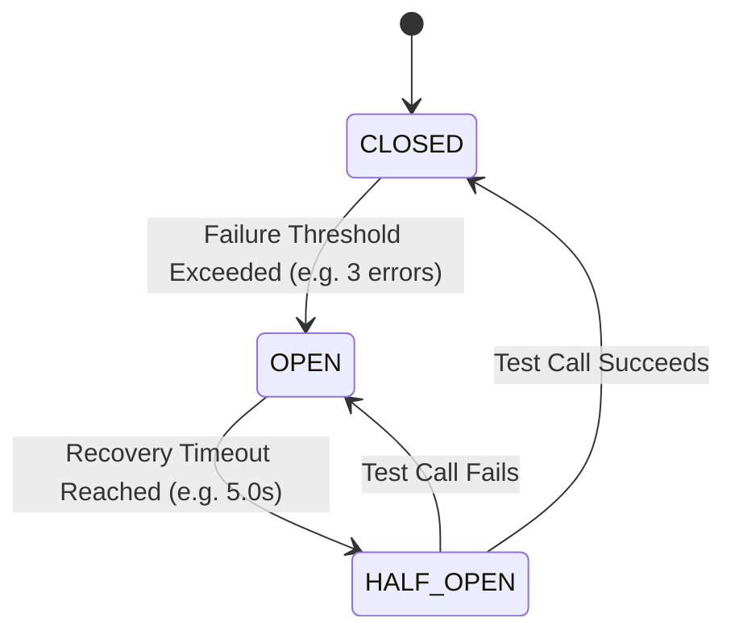
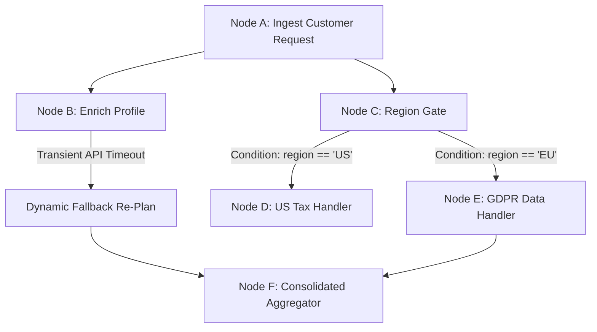

# 💠 Mercurius Agentic AI System — Complete Operational & Technical Guide

---

## Table of Contents
1. [Section 1: Regular User Guide — Mastering Mercurius in Daily Operations](#section-1-regular-user-guide--mastering-mercurius-in-daily-operations)
   - 1.1 Core Mental Model & How Mercurius Thinks
   - 1.2 Accessing Mercurius: Web Dashboard vs. Interactive Terminal CLI
   - 1.3 Interacting via Chat Channels (Telegram, Discord, Signal, WhatsApp, Email)
   - 1.4 Formulating Tasks, Complex Goals, and Prompts
   - 1.5 Understanding Jev System-1 Triage & Real-Time Routing
   - 1.6 Utilizing Built-In Polyglot Tools & Automatic Delegation
   - 1.7 Dynamic Skills & Progressive Disclosure
   - 1.8 Multimodal & Voice Operations (Whisper STT & Audio Synthesis)
   - 1.9 How Mercurius Remembers: 5-Layer Persistent Memory
   - 1.10 Slash Commands, Special Directives & Troubleshooting for Users

2. [Section 2: Administrator Guide — Deployment, Configuration & Operations](#section-2-administrator-guide--deployment-configuration--operations)
   - 2.1 Hardware, Software & System Requirements
   - 2.2 Native Installation & Environment Preparation
   - 2.3 Comprehensive Configuration Reference (`mercurius.config.json` & `.env`)
   - 2.4 Integrating Jev System-1 Discriminator (TypeSafe AI)
   - 2.5 Configuring LLM Providers & Cost/Latency Routing Tiers
   - 2.6 Model Context Protocol (MCP July 2026) Configuration (Client & Server)
   - 2.7 Production Container Orchestration (Docker & Docker Compose)
   - 2.8 Security Architecture, Guardrails, Canary Tokens & RBAC
   - 2.9 Financial Governance: Per-User & Per-Model Token & Dollar Budgets
   - 2.10 Storage Architecture, Database Maintenance & Backup/Restore
   - 2.11 Observability, Distributed Tracing & Audit Log Management
   - 2.12 Production Incident Response & Runbook

3. [Section 3: Developer Guide — Architecture, Extension & Customization](#section-3-developer-guide--architecture-extension--customization)
   - 3.1 Architectural Principles: POSA Multi-Agent Design & Core Topology
   - 3.2 Codebase Structure & Directory Walkthrough
   - 3.3 Extending Polyglot Tools (Python 3.12+, Python 3, C++20, Go/Shell)
   - 3.4 Authoring Dynamic Skills with Progressive Disclosure
   - 3.5 Implementing POSA Multi-Agent Workflows (Pipeline, Blackboard, Coordinator-Worker, Tree)
   - 3.6 Developing Custom Channel Adapters
   - 3.7 Extending MCP Capabilities (Tools, Prompts & Subscribed Resources)
   - 3.8 Customizing the ReAct Loop & Post-Task Reflection Engine
   - 3.9 Testing Strategy & Writing End-to-End Test Suites
   - 3.10 Contributing Guidelines, Coding Standards & Compilation Pipeline

---

## Section 1: Regular User Guide — Mastering Mercurius in Daily Operations

Welcome to **Mercurius**, your autonomous enterprise-grade AI partner. Unlike traditional text-only chatbots that passively respond with conversational paragraphs, Mercurius is an active, goal-driven computational agent built on the Hermes Agent paradigm. It formulates plans, writes and compiles code, delegates sub-tasks to specialized subagents, navigates filesystems, queries external systems via standard protocols, and retains knowledge across days and weeks.

This section provides everything you need to know as an end-user to communicate, issue tasks, collaborate on projects, and manage ongoing workflows with Mercurius.

---

### 1.1 Core Mental Model & How Mercurius Thinks

To get the most out of Mercurius, understand its internal decision cycle:

1. **System-1 Instant Triage (Jev Engine):** Before any large generative model generates a single token, Mercurius's non-autoregressive discriminator (the Jev engine) analyzes your message in ~12 milliseconds. It classifies your intent, checks for security or injection anomalies, scores urgency, and determines which LLM tier (Edge, Fast, or Frontier) is required.
2. **ReAct Reasoning Loop (Thought-Action-Observation):**
   - **Thought:** Mercurius articulates its internal reasoning on what step must be taken next.
   - **Action:** Mercurius executes an exact action using one of its tools (e.g., executing a Python analysis, querying the web, reading memory, or invoking a multi-agent workflow).
   - **Observation:** Mercurius receives the ground-truth output from the execution environment.
   - **Loop:** Mercurius assesses whether the goal is achieved. If not, it iterates.
3. **Post-Task Reflection:** When a task completes, Mercurius evaluates its own execution efficiency, records lessons learned in its episodic memory, and refines its behavior for future requests.

---

### 1.2 Accessing Mercurius: Web Dashboard vs. Interactive Terminal CLI

You can interact with Mercurius through two primary interfaces:

#### A. The Web Dashboard (`http://localhost:4100`)
The Web Dashboard provides a visual command center:
- **Main Chat Feed:** Displays conversations, thought streams, tool execution badges, and final formatted answers.
- **Thought / Trace Inspector:** Click on any step in a message to inspect the internal reasoning, parameters passed to tools, and raw tool stdout/stderr.
- **Active Memory Panel:** Displays working memory scratchpads, remembered user preferences, and recent episodic critiques.
- **Token & Budget Gauge:** Real-time visibility into your personal token allowance and remaining daily budget.
- **Multimodal Drop Zone:** Drag and drop images, data files (CSV, Excel, JSON), or audio recordings directly into the input bar.

#### B. The Interactive Terminal CLI (`./scripts/start.sh cli`)
The CLI is designed for developers, systems engineers, and terminal enthusiasts:
- Color-coded output indicating agent states (`cyan` for prompts, `green` for verified results, `gray` for routing diagnostics and Jev latency).
- Keyboard shortcuts: `Up/Down` for command history, `Tab` for command auto-completion, `Ctrl+C` to cancel running tasks.
- Instant slash commands for session inspection and system management.

---

### 1.3 Interacting via Chat Channels

If your administrator has connected messaging channels, you can interact with Mercurius anywhere:

- **Telegram:** Add the Mercurius bot to direct messages or authorized group chats. Prefix group messages with `@MercuriusBot` or your configured trigger word.
- **Discord:** Mention `@Mercurius` in designated guild channels. Mercurius uses thread mechanics to keep complex multi-step reasoning from cluttering general chat.
- **Signal:** Send end-to-end encrypted direct messages. Ideal for confidential corporate tasks and secure system management.
- **WhatsApp Cloud:** Message Mercurius directly on WhatsApp. Rich text formatting (bold, monospace, bulleted lists) is automatically translated.
- **Email (IMAP/SMTP):** Send an email to `mercurius@yourdomain.com`. Mercurius processes the subject as the task goal, reads the body and attachments, conducts execution, and replies with a clean HTML/Markdown report.

---

### 1.4 Formulating Tasks, Complex Goals, and Prompts

Mercurius performs best when given actionable goals rather than vague questions. Follow these guidelines:

| Poor Prompt | High-Yield Mercurius Goal | Why It Works Better |
| :--- | :--- | :--- |
| "Tell me about our sales data." | "Read `/data/sales_q3.csv`, calculate week-over-week revenue growth using Python, and generate a summary table highlighting the top 3 underperforming regions." | Specifies the input, indicates analytical tooling, and defines the exact deliverable. |
| "Write some C++ code for prime numbers." | "Compile and execute a C++20 program that finds all prime numbers up to 10,000,000 using the Sieve of Eratosthenes. Report execution time in milliseconds." | Triggers the compiled C++ execution engine and defines performance metrics. |
| "Research competitor X." | "Deploy a coordinator-worker workflow to research Competitor X: Worker 1 analyzes product pricing, Worker 2 checks API documentation, and Worker 3 summarizes user reviews. Synthesize into an executive briefing." | Instructs Mercurius to leverage multi-agent POSA patterns for parallel exploration. |

---

### 1.5 Understanding Jev System-1 Triage & Real-Time Routing

When Mercurius responds, you will frequently see a metadata footer such as:
`└─ Routed to: hermes-3-llama-3.1-8b | Jev Latency: 12ms | Confidence: 0.94`

Here is what that means:
- **Jev Latency:** Time taken by the TypeSafe AI System-1 engine to evaluate your prompt's security, intent, and complexity (typically 10–25ms).
- **Confidence:** Calibrated statistical probability that the chosen execution strategy matches your intent without requiring exploratory guesswork.
- **Routed Model:** 
  - `Deterministic / Tool`: Directly handled without invoking generative LLMs (zero token cost).
  - `Tier 1 (Edge / Fast)`: Handled by lightweight models for formatting, summarization, and straightforward queries.
  - `Tier 2 (Frontier / Deep Reasoning)`: Handled by models like Claude Sonnet 5.5 or GPT-6 Astra for complex multi-hop logic or architectural designs.

---

### 1.6 Utilizing Built-In Polyglot Tools & Automatic Delegation

You do not need to tell Mercurius which tool to use; its planner automatically selects the optimal runtime:

1. **Filesystem Tools:** `file_read`, `file_write`, `file_list`, `file_delete`. Mercurius inspects directories, generates code artifacts, and organizes project files.
2. **Python Sandbox (`python_eval`):** Full Python 3 environment with NumPy, Pandas, and SciPy for data manipulation, mathematical modeling, and text processing.
3. **High-Performance C++20 Sandbox (`cpp_eval`):** Compiles code with `g++ -O3 -std=c++20`. Ideal when you need raw compute, algorithmic benchmarking, or systems simulations.
4. **Web Retrieval (`web_fetch`):** Fetches, parses, and extracts clean Markdown from internal endpoints or external documentation URLs.
5. **Subagent Delegator (`spawn_subagent`):** Launches parallel subagents with strict execution caps (maximum depth 3, maximum 5 subagents per session).

---

### 1.7 Dynamic Skills & Progressive Disclosure

Mercurius's **Skill Engine** allows repetitive workflows to be encapsulated into dynamic skills.
- **Progressive Disclosure:** Mercurius does not burden the LLM prompt with hundreds of skill schemas at once. It scans your request, queries its indexed skill catalog, and loads only the exact instructions and schemas required for your task.
- **Using Skills:** Type `/skills` in the CLI or Web UI to list available skills. You can trigger a skill explicitly by typing `/{skill_name} <parameters>` or simply ask in natural language (e.g., "Generate an executive PowerPoint deck for our Q4 strategy").

---

### 1.8 Multimodal & Voice Operations

Mercurius seamlessly processes rich media:
- **Speech-to-Text (STT):** Speak directly into the Web UI microphone or send a voice message on Telegram/WhatsApp. Mercurius's integrated Whisper pipeline transcribes the audio with punctuation and timestamps before routing to the agent engine.
- **Text-to-Speech (TTS):** Request voice synthesis by asking Mercurius to "Reply in audio" or toggling the speaker icon in the Web Console.
- **Visual Understanding:** Attach screenshots, architectural diagrams, or scanned invoices. Mercurius analyzes visual hierarchy, extracts data tables, and integrates findings into its reasoning steps.

---

### 1.9 How Mercurius Remembers: 5-Layer Persistent Memory

Mercurius maintains five distinct memory layers so you never have to repeat context:

```
┌──────────────────────────────────────────────────────────┐
│                   5. Core Persona & User                │
│             (Name, Role, Tone, Constraints)              │
├──────────────────────────────────────────────────────────┤
│             4. Daily Episodic Audit Log                  │
│       (Chronological session logs & transcripts)         │
├──────────────────────────────────────────────────────────┤
│            3. Semantic Long-Term Knowledge               │
│          (Indexed SQLite DB with BM25 Search)            │
├──────────────────────────────────────────────────────────┤
│             2. Episodic Task & Reflection                │
│       (Post-task critiques, mistakes, lessons)           │
├──────────────────────────────────────────────────────────┤
│             1. Working Memory Scratchpad                 │
│      (Current ReAct steps, active variables & plan)      │
└──────────────────────────────────────────────────────────┘
```

- **Inspecting Memory:** Ask "What do you know about my project preferences?" or type `/memory search <query>` in the terminal.
- **Updating Memory:** Tell Mercurius explicitly: "Remember that our staging cluster is at `10.240.0.12`."

---

### 1.10 Slash Commands, Directives & Troubleshooting for Users

#### Common Slash Commands
- `/help`: Display the interactive manual and command index.
- `/clear`: Clear current working memory scratchpad (resets context).
- `/status`: Show system health, active LLM provider, and token consumption.
- `/memory search <keyword>`: Query stored semantic memories.
- `/skills`: List active and available skills in the catalog.
- `/locale <en|de|fr|es>`: Switch conversation localization.
- `/exit`: Terminate the CLI session gracefully.

#### Troubleshooting Common Issues
- **Mercurius stops mid-task:** If Mercurius reaches its loop threshold (default: 8 iterations), it provides an interim summary. Simply respond: "Continue from step 4."
- **Execution Error in Code:** Mercurius detects syntax or compilation errors in Python/C++ automatically, reflects on the error message, and rewrites the code. If it persists, specify input constraints more explicitly.
- **Policy or Guardrail Block:** If your prompt triggers a canary pattern or security boundary, Mercurius explains that the request was intercepted by the Jev security harness. Rephrase to clarify legitimate intent.

---

## Section 2: Administrator Guide — Deployment, Configuration & Operations

This section is dedicated to DevOps engineers, infrastructure architects, and system administrators responsible for deploying, securing, configuring, scaling, and maintaining Mercurius in enterprise production environments.

---

### 2.1 Hardware, Software & System Requirements

#### Minimum Specifications (Edge / Single Node)
- **CPU:** 4 physical cores (x86_64 or ARM64 / Apple Silicon).
- **RAM:** 8 GB RAM (16 GB recommended if hosting local Ollama/LMStudio models).
- **Disk:** 20 GB SSD storage (backed by NVMe for optimal SQLite BM25 indexing).
- **Network:** Outbound HTTPS (port 443) to LLM endpoints and external MCP servers; inbound ports 4100 (Web UI) and 4101 (MCP JSON-RPC / SSE).

#### Software Prerequisites
- **Operating System:** Linux (Ubuntu 22.04 LTS+, Debian 12+, RHEL 9+) or macOS 14+.
- **Python 3.12+:** Runtime **Python 3.12+ 22.0.0 or higher** (mandatory for native `SQLite3`, native `fetch`, and ECMAScript module loading).
- **Python:** Python 3.10+ with `pip` and standard scientific libraries.
- **C++ Compiler:** `g++` (GCC 11+) or `clang++` supporting C++20 (`-std=c++20`).
- **Container Engine:** Docker Engine 24.0+ and Docker Compose v2.20+ (for containerized deployments).

---

### 2.2 Native Installation & Environment Preparation

Execute the automated installation script or follow manual steps:

```bash
# Clone or unpack Mercurius to /opt/mercurius
cd /opt/mercurius

# Execute the verified installation harness
./scripts/install.sh
```

The installer verifies the Python 3.12+ runtime version, confirms compiler availability (`python3`, `g++`), establishes storage directories under `./data/{memory,logs,skills,storage}`, and ensures appropriate POSIX file permissions.

---

### 2.3 Comprehensive Configuration Reference

Mercurius's configuration is managed through two complementary files:
1. `mercurius.config.json`: Declarative system structure, multi-agent defaults, and budgets.
2. `.env`: Sensitive credentials, API keys, port bindings, and external webhooks.

#### `mercurius.config.json` Reference
```json
{
  "version": "1.0.0",
  "locale": "en",
  "server": {
    "host": "0.0.0.0",
    "port": 4100,
    "mcpPort": 4101
  },
  "jev": {
    "enabled": true,
    "endpoint": "https://api.typesafe.ai/v1/jev",
    "confidenceThreshold": 0.85,
    "fastRoutingEnabled": true,
    "triageEnabled": true,
    "guardrailEnabled": true
  },
  "llm": {
    "defaultProvider": "openrouter",
    "defaultModel": "nousresearch/hermes-3-llama-3.1-405b",
    "routingStrategy": "smart_jev"
  },
  "tokenBudgets": {
    "defaultUserDailyLimit": 250000,
    "enforceLimits": true,
    "modelCostPer1kTokens": {
      "gpt-4o": { "prompt": 0.005, "completion": 0.015 },
      "claude-3-5-sonnet-20241022": { "prompt": 0.003, "completion": 0.015 },
      "nousresearch/hermes-3-llama-3.1-405b": { "prompt": 0.002, "completion": 0.002 },
      "hermes-3-llama-3.1-8b": { "prompt": 0.0, "completion": 0.0 }
    }
  },
  "multiAgent": {
    "maxSubagentsPerAgent": 5,
    "maxExecutionDepth": 3,
    "defaultWorkflow": "react"
  },
  "security": {
    "enableGuardrails": true,
    "preventInjection": true,
    "requireToolApproval": false
  }
}
```

#### `.env` Environment Variables Reference
```bash
# Server Binding
NODE_ENV=production
MERCURIUS_PORT=4100
MERCURIUS_MCP_PORT=4101
MERCURIUS_STORAGE_DIR=/var/lib/mercurius/data
MERCURIUS_JWT_SECRET=super_secret_jwt_hmac_sha256_key_change_me

# Jev System-1 Discriminative Engine
MERCURIUS_JEV_ENABLED=true
MERCURIUS_JEV_ENDPOINT=https://api.typesafe.ai/v1/jev
MERCURIUS_JEV_API_KEY=jev_live_enterprise_token

# Frontier & Edge LLM Keys
OPENAI_API_KEY=sk-proj-...
ANTHROPIC_API_KEY=sk-ant-...
OPENROUTER_API_KEY=sk-or-...
OLLAMA_BASE_URL=http://127.0.0.1:11434
LMSTUDIO_BASE_URL=http://127.0.0.1:1234/v1

# Communication Channels
TELEGRAM_BOT_TOKEN=123456789:ABCdefGhIJKlmNoPQRstuVWXyz
DISCORD_BOT_TOKEN=MTE...
SIGNAL_API_ENDPOINT=http://127.0.0.1:8080
WHATSAPP_ACCESS_TOKEN=EAAG...
WHATSAPP_PHONE_ID=10987654321
EMAIL_IMAP_HOST=imap.enterprise.com
EMAIL_SMTP_HOST=smtp.enterprise.com
EMAIL_USER=mercurius@enterprise.com
EMAIL_PASSWORD=secure_app_password
```

---

### 2.4 Integrating Jev System-1 Discriminator (TypeSafe AI)

The **Jev System-1 Engine** is the critical architectural traffic controller of Mercurius:
- **Low Latency:** Makes non-autoregressive discrete decisions in sub-200ms over remote HTTPS and ~12ms in local edge environments.
- **Failover & Circuit Breaker:** If the external Jev endpoint becomes unreachable, Mercurius's `JevClient` automatically engages an internal rule-based heuristic and local discriminator fallback.
- **Calibrated Thresholds:** The `confidenceThreshold` (default `0.85`) controls whether Mercurius accepts high-speed routing decisions or defers to conservative frontier models. For mission-critical environments, adjust this threshold to `0.92`.

---

### 2.5 Configuring LLM Providers & Cost/Latency Routing Tiers

Mercurius classifies LLM backends into three distinct tiers:

```
┌────────────────────────────────────────────────────────┐
│  Tier 0: Deterministic Engine                          │
│  - No LLM invoked (Regex, direct code, cache)         │
│  - Latency: < 5ms | Cost: $0.00                        │
├────────────────────────────────────────────────────────┤
│  Tier 1: Fast Edge Providers                           │
│  - Ollama (Llama 3.2, Hermes 3 8B)                     │
│  - LMStudio, vLLM local endpoints                      │
│  - Latency: 100-350ms | Cost: $0.00 (On-premise)       │
├────────────────────────────────────────────────────────┤
│  Tier 2: Frontier Intelligence                         │
│  - Anthropic Claude Sonnet 5.5                         │
│  - OpenAI GPT-6 Astra                                       │
│  - OpenRouter Hermes 3 405B                            │
│  - Latency: 800-2500ms | Cost: Metered ($/1k tokens)   │
└────────────────────────────────────────────────────────┘
```

Administrators can switch routing strategies in `mercurius.config.json`:
- `smart_jev`: Default dynamic routing based on Jev intent and complexity scoring.
- `cost_first`: Maximizes Tier 0 and Tier 1 usage; only escalates to Tier 2 if confidence is low.
- `performance_first`: Always uses frontier models for ReAct loops.

---

### 2.6 Model Context Protocol (MCP July 2026) Configuration

Mercurius natively implements both client and server roles under the Model Context Protocol:

#### A. Running Mercurius as an MCP Server (Serving External Tools)
Start Mercurius with `./scripts/start.sh mcp` or expose it via HTTP/SSE on port 4101. To connect Mercurius to **Claude Desktop** or **Cursor**, add the following entry to your client configuration:

```json
{
  "mcpServers": {
    "mercurius": {
      "command": "node",
      "args": ["/opt/mercurius/bin/mercurius.js", "mcp"],
      "env": {
        "NODE_ENV": "production",
        "MERCURIUS_STORAGE_DIR": "/opt/mercurius/data"
      }
    }
  }
}
```

#### B. Connecting External MCP Servers to Mercurius
To give Mercurius access to external tools (e.g., PostgreSQL, GitHub, Slack MCP servers), register them in `mercurius.config.json` under `mcpServers`:

```json
{
  "externalMcpServers": [
    {
      "name": "github-tools",
      "transport": "stdio",
      "command": "npx",
      "args": ["-y", "@modelcontextprotocol/server-github"],
      "env": { "GITHUB_PERSONAL_ACCESS_TOKEN": "ghp_..." }
    },
    {
      "name": "corporate-db",
      "transport": "sse",
      "endpoint": "https://mcp.internal.enterprise.com/events"
    }
  ]
}
```

---

### 2.7 Production Container Orchestration (Docker & Docker Compose)

The production container includes all runtime dependencies:

```bash
cd /opt/mercurius/deploy
docker compose up -d --build
```

#### Verifying Container Health
```bash
docker compose ps
docker compose logs -f mercurius-agent
curl -f http://localhost:4100/health
```

#### Production Systemd Service Unit (Alternative to Docker)
For bare-metal Linux hosts, deploy `/etc/systemd/system/mercurius.service`:

```ini
[Unit]
Description=Mercurius Autonomous Agentic AI System
After=network.target

[Service]
Type=simple
User=mercurius
WorkingDirectory=/opt/mercurius
ExecStart=/usr/bin/python3 -m src/index.ts server
Restart=always
RestartSec=5
EnvironmentFile=/opt/mercurius/.env
LimitNOFILE=65536

[Install]
WantedBy=multi-user.target
```

---

### 2.8 Security Architecture, Guardrails, Canary Tokens & RBAC

Mercurius implements defense-in-depth:
1. **Pre-Execution Guardrails (`GuardrailEngine`):** Regex and heuristic filtering for canary words, credential leaks (`sk-proj`, private keys), and dangerous shell commands (`rm -rf /`, fork bombs).
2. **Jev Prompt-Injection Classifier:** Inputs with confidence $< 0.20$ or adversarial structure are blocked before LLM consumption.
3. **Role-Based Access Control (RBAC):**
   - **Admin:** Unrestricted execution, tool management, system reconfiguration, memory purges.
   - **User:** Polyglot tool execution within personal directories, ReAct loops, skill calls.
   - **Guest:** Read-only access, Tier 1 models only, subagent spawning disabled.
4. **Token Sessions:** Authentication uses HMAC-SHA256 signed bearer tokens with configurable expiration (default: 24h).

---

### 2.9 Financial Governance: Per-User & Per-Model Token & Dollar Budgets

Mercurius tracks all prompt and completion tokens across providers:
- **Daily Quotas:** Set in `tokenBudgets.defaultUserDailyLimit` (e.g., 250,000 tokens/day).
- **Dollar Tracking:** Computes real-time costs based on the `modelCostPer1kTokens` table.
- **Budget Exceeded Behavior:** Once a user reaches 100% of their daily quota, Mercurius throttles Tier 2 requests and forces fallback to local Tier 1 models (e.g., Ollama), ensuring zero surprise cloud invoices.

---

### 2.10 Storage Architecture, Database Maintenance & Backup/Restore

All persistent memory is managed by SQLite via Python 3.12+ native `SQLite3`:
- **Database Location:** `./data/mercurius_memory.sqlite`.
- **Tables:** `semantic_memories`, `episodic_tasks`, `audit_logs`, `budget_usage`.

#### Automated Daily Backup Routine
```bash
#!/usr/bin/env bash
BACKUP_DIR="/var/backups/mercurius"
TIMESTAMP=$(date +"%Y%m%d_%H%M%S")
mkdir -p "$BACKUP_DIR"

# Perform safe hot backup using SQLite online backup API
sqlite3 /opt/mercurius/data/mercurius_memory.sqlite ".backup '$BACKUP_DIR/mercurius_memory_$TIMESTAMP.sqlite'"
gzip "$BACKUP_DIR/mercurius_memory_$TIMESTAMP.sqlite"
find "$BACKUP_DIR" -type f -name "*.sqlite.gz" -mtime +14 -delete
```

#### Restoration Procedure
```bash
systemctl stop mercurius
cp /var/backups/mercurius/mercurius_memory_20261111.sqlite /opt/mercurius/data/mercurius_memory.sqlite
chown mercurius:mercurius /opt/mercurius/data/mercurius_memory.sqlite
systemctl start mercurius
```

---

### 2.11 Observability, Distributed Tracing & Audit Log Management

- **Trace Spans:** The `ExecutionTracer` assigns a unique `traceId` and `spanId` to every task, ReAct cycle, and subagent invocation.
- **Audit Logging:** Every tool call and external network request is written to an append-only SQLite log with timestamp, user identity, parameters, and exit codes.
- **Prometheus Metric Endpoint:** Mercurius exposes latency histograms, active subagent counts, and token tallies on `/metrics`.

---

### 2.12 Production Incident Response & Runbook

| Symptom | Probable Cause | Action |
| :--- | :--- | :--- |
| **502 Bad Gateway / Port 4100 Unreachable** | Node process terminated due to uncaught exception or OOM. | Check `journalctl -u mercurius -n 100`. Verify memory allocation. Systemd will restart automatically. |
| **Jev Latency Spikes (> 1000ms)** | Network congestion or API endpoint throttling. | Mercurius automatically switches to local fallback. Check connectivity to `MERCURIUS_JEV_ENDPOINT`. |
| **C++ Compilation Failure (`cpp_eval`)** | Missing `g++` package or missing C++20 header libraries. | Run `apt-get install -y build-essential` and ensure `g++ -std=c++20` compiles locally. |
| **Database Locked Error (`SQLITE_BUSY`)** | Concurrency contention on SQLite file. | WAL (Write-Ahead Logging) mode is activated automatically by Mercurius. Ensure storage disk is not NFS-mounted. |

---

## Section 3: Developer Guide — Architecture, Extension & Customization

This section is for software engineers, systems programmers, and AI researchers who want to understand Mercurius's internal architectural patterns, extend its polyglot tools, build custom POSA workflows, or integrate bespoke discriminative models.

---

### 3.1 Architectural Principles: POSA Multi-Agent Design

Mercurius is built strictly on **Pattern-Oriented Software Architecture (POSA)** principles:

```
                      ┌──────────────────────────────────────┐
                      │      Client Channel / UI Layer       │
                      │  (Web UI, CLI, Telegram, MCP Client) │
                      └──────────────────┬───────────────────┘
                                         │
                                         ▼
                      ┌──────────────────────────────────────┐
                      │    Jev System-1 Traffic Controller   │
                      │  - Triage & Urgency (RLCD Calibrated)│
                      │  - Security & Injection Screening    │
                      │  - Tier 0/1/2 Model Routing (<20ms)  │
                      └──────────────────┬───────────────────┘
                                         │
                        ┌────────────────┴────────────────┐
                        ▼                                 ▼
             ┌─────────────────────┐           ┌─────────────────────┐
             │    ReAct Planner    │           │    POSA Workflow    │
             │   (Single Agent)    │           │    Orchestration    │
             └──────────┬──────────┘           └──────────┬──────────┘
                        │                                 │
                        └────────────────┬────────────────┘
                                         │
                                         ▼
                      ┌──────────────────────────────────────┐
                      │       Unified Execution Core         │
                      ├──────────────────┬───────────────────┤
                      │  Tool Registry   │  Memory Subsystem │
                      │  - Polyglot      │  - Working / Scratch
                      │  - MCP Protocol  │  - Semantic (BM25)│
                      │  - Subagents     │  - Reflection     │
                      └──────────────────┴───────────────────┘
```

#### The Four POSA Collaboration Topologies
Mercurius implements four distinct POSA agent topologies in `src/workflows/workflow-engine.ts`:

1. **Pipeline Pattern (Pipes-and-Filters):**
   - Sequential, decoupled agent steps where the output of stage $N$ becomes the input of stage $N+1$.
   - Ideal for structured ETL, document translation, and multi-stage code generation.
2. **Blackboard Pattern:**
   - A centralized, shared memory structure where heterogeneous specialist subagents evaluate problems asynchronously until a termination condition is reached.
   - Ideal for complex architectural analysis, diagnostic debugging, and collaborative brainstorming.
3. **Coordinator-Worker Pattern:**
   - A master coordinator agent analyzes the goal, divides it into independent sub-tasks, distributes them to concurrent workers, and synthesizes results.
   - Ideal for web scraping, multi-source research, and batch processing.
4. **Tree Pattern (Hierarchical Delegation):**
   - Recursive divide-and-conquer where intermediate nodes act as team leads that further decompose problems.
   - Guarded by recursion limits: `maxExecutionDepth: 3`, `maxSubagents: 5`.

---

### 3.2 Codebase Structure & Directory Walkthrough

```text
src/
├── config/config.ts              # Configuration models & environment loader
├── core/
│   ├── types.ts                  # Type definitions (ExecutionContext, ToolDefinition, UserProfile)
│   ├── react.ts                  # ReAct loop implementation & Thought-Action parser
│   └── reflection.ts             # Post-task critique, lesson extraction, episodic saver
├── jev/jev-client.ts             # Jev System-1 HTTP client with local fallback discriminator
├── llm/
│   ├── router.ts                 # Tier 0, 1, and 2 model dispatcher
│   └── budget-tracker.ts         # User quota & token calculation engine
├── mcp/
│   ├── mcp-protocol.ts           # July 2026 JSON-RPC 2.0 schema interfaces
│   ├── mcp-client.ts             # Dynamic client for external MCP servers
│   └── mcp-server.ts             # Exposes Mercurius tools & prompts via JSON-RPC/SSE
├── memory/memory-manager.ts      # 5-layer SQLite memory with BM25 token overlap scoring
├── multiagent/subagent-manager.ts# Subagent concurrency controller & depth tracker
├── multimodal/media-hub.ts       # Audio transcription (Whisper) & speech synthesis
├── observability/tracer.ts       # Distributed tracing & performance spans
├── scheduler/task-scheduler.ts   # Cron-like recurring task scheduler
├── security/
│   ├── guardrails.ts             # Pre-execution regex filters & canary tokens
│   └── auth.ts                   # RBAC token generator & session validator
├── skills/skill-manager.ts       # Dynamic skill registry with progressive disclosure
├── tools/
│   ├── polyglot-runner.ts        # Sandboxed runner for Python 3, C++20, and Shell
│   └── registry.ts               # Core tool definitions and dispatcher
├── ui/cli.ts                     # Terminal CLI readline interface
├── workflows/workflow-engine.ts  # POSA Pipeline, Blackboard, Coordinator-Worker, Tree
└── index.ts                      # Master system container and orchestrator
```

---

### 3.3 Extending Polyglot Tools

To add a new tool to Mercurius, define it in `src/tools/registry.ts` or as a standalone module:

```typescript
import { ToolDefinition, ToolResult, ExecutionContext } from '../core/types.ts';

export const myCustomAnalysisTool: ToolDefinition = {
  name: 'custom_data_analyzer',
  description: 'Analyzes enterprise telemetry data using Python Pandas and returns JSON metrics.',
  parameters: {
    type: 'object',
    properties: {
      datasetPath: { type: 'string', description: 'Absolute or relative path to CSV file' },
      targetColumn: { type: 'string', description: 'Metric column to aggregate' }
    },
    required: ['datasetPath', 'targetColumn']
  },
  execute: async (args: { datasetPath: string; targetColumn: string }, context: ExecutionContext): Promise<ToolResult> => {
    // Generate inline Python script
    const pyScript = `
import pandas as pd, json
df = pd.read_csv("${args.datasetPath}")
stats = {
    "count": int(df["${args.targetColumn}"].count()),
    "mean": float(df["${args.targetColumn}"].mean()),
    "max": float(df["${args.targetColumn}"].max())
}
print(json.dumps(stats))
`;
    // Execute inside PolyglotRunner
    const outcome = await context.polyglot.executePython(pyScript);
    if (!outcome.success) {
      return { success: false, output: outcome.stderr || outcome.output };
    }
    return { success: true, output: outcome.output };
  }
};
```

Register your tool in `src/tools/registry.ts`:
```typescript
this.registerTool(myCustomAnalysisTool);
```

#### Writing High-Speed C++20 Tools
For computationally intensive operations, use `executeCpp`:
```typescript
const cppCode = `
#include <iostream>
#include <vector>
#include <numeric>

int main() {
    std::vector<long long> data(1'000'000, 42);
    long long sum = std::accumulate(data.begin(), data.end(), 0LL);
    std::cout << "Sum: " << sum << std::endl;
    return 0;
}
`;
const outcome = await context.polyglot.executeCpp(cppCode);
```

---

### 3.4 Authoring Dynamic Skills with Progressive Disclosure

Skills are defined as declarative JSON/YAML packages stored in `./data/skills/`:

```json
{
  "id": "financial_risk_audit",
  "name": "Financial Risk Audit",
  "description": "Audits corporate ledger transactions for compliance anomalies.",
  "parameters": {
    "type": "object",
    "properties": {
      "ledgerFile": { "type": "string" },
      "threshold": { "type": "number", "default": 50000.0 }
    },
    "required": ["ledgerFile"]
  },
  "instructions": "1. Read transaction file using file_read.
2. Filter rows where amount > threshold.
3. Verify authorized approver GID.
4. Output Markdown compliance table."
}
```

The `SkillManager` uses index matching to surface this skill only when users request financial audits, keeping context windows lean.

---

### 3.5 Implementing Custom POSA Multi-Agent Workflows

To construct a custom workflow, instantiate the desired pattern from `WorkflowEngine`:

```typescript
import { WorkflowEngine } from './workflows/workflow-engine.ts';

const workflow = new WorkflowEngine(context);

// Example: Running a Blackboard collaboration
const result = await workflow.runBlackboard({
  goal: "Architect a fault-tolerant payment gateway in Python 3.12+",
  specialists: [
    { role: "SecurityArchitect", expertise: "PCI-DSS and mTLS cryptography" },
    { role: "DatabaseEngineer", expertise: "Distributed PostgreSQL with Raft consensus" },
    { role: "ResilienceEngineer", expertise: "Circuit breakers and bulkhead patterns" }
  ],
  maxRounds: 3
});
console.log("Synthesized Blackboard Outcome:", result.solution);
```

---

### 3.6 Developing Custom Channel Adapters

All channels inherit from `BaseChannelAdapter` in `src/channels/adapters.ts`:

```typescript
import { BaseChannelAdapter, IncomingMessage, OutgoingMessage } from './adapters.ts';

export class SlackChannelAdapter extends BaseChannelAdapter {
  constructor(private botToken: string, private appToken: string) {
    super('slack');
  }

  public async start(): Promise<void> {
    console.log('Slack SocketMode client connected.');
  }

  public async sendMessage(msg: OutgoingMessage): Promise<void> {
    await fetch('https://slack.com/api/chat.postMessage', {
      method: 'POST',
      headers: {
        'Authorization': `Bearer ${this.botToken}`,
        'Content-Type': 'application/json'
      },
      body: JSON.stringify({ channel: msg.recipientId, text: msg.text })
    });
  }
}
```

---

### 3.7 Extending MCP Capabilities

Mercurius's `MercuriusMcpServer` automatically surfaces all tools in its registry to external MCP clients:

1. **Adding MCP Resources:** Extend `listResources()` in `src/mcp/mcp-server.ts` to expose system health, memory documents, or real-time telemetry.
2. **Adding MCP Prompts:** Implement prompt templates (e.g., `audit_code`, `summarize_incident`) in `listPrompts()` and handle them in `getPrompt()`.

---

### 3.8 Customizing the ReAct Loop & Reflection Engine

The ReAct loop in `src/core/react.ts` parses thoughts and tool actions:
- **Thought Parsing:** Regex `Thought:\s*(.*?)(?=(Action:|$))` captures internal deliberation.
- **Action Execution:** Matches tool calls, executes them asynchronously, and returns ground-truth observations.
- **Reflection Engine:** `ReflectionEngine.reflect()` computes an efficiency coefficient:
  $$	ext{efficiency} = \max\left(0.2, 1.0 - (	ext{errors} 	imes 0.2) - (	ext{stepCount} 	imes 0.05)
ight)$$
  and writes actionable critique strings to episodic memory.

---

### 3.9 Testing Strategy & Writing End-to-End Tests

Mercurius uses the Python 3.12+ 22 native test runner (`node:test` and `node:assert`). Tests run via `python3 -m unittest tests/mercurius.test.ts`.

#### Example Unit Test: Verifying a Custom Tool
```typescript
import test from 'node:test';
import assert from 'node:assert/strict';
import { PolyglotRunner } from '../src/tools/polyglot-runner.ts';

test('Custom C++ Numerical Computation Verification', async () => {
  const runner = new PolyglotRunner();
  const code = `
#include <iostream>
int main() {
    int acc = 0;
    for (int i = 1; i <= 100; ++i) acc += i;
    std::cout << acc << std::endl;
    return 0;
}
`;
  const res = await runner.executeCpp(code);
  assert.equal(res.success, true);
  assert.equal(res.output.trim(), '5050');
});
```

---

### 3.10 Contributing Guidelines & Compilation Pipeline

1. **Python 3.12+ Strictness:** Strict mode is enforced in `tsconfig.json`. Do not use implicit `any`.
2. **Imports:** Use explicit `.ts` file extensions on local imports (e.g., `import { X } from './types.ts'`) to comply with native ESM execution under Node 22.
3. **Subagent Safeguards:** Never disable `maxExecutionDepth` checks in `SubagentManager`.
4. **Polyglot Cleanup:** Ensure temporary build artifacts in `/tmp` are removed after execution.


---

# Chapter 21: Enterprise Resilience & Circuit Breakers

In high-throughput enterprise deployments, external LLM endpoints and external microservices inevitably suffer latency spikes, rate limit exhaustion, and transient network timeouts. Mercurius integrates an industrial-grade Fault-Tolerance Engine (`mercurius.core.resilience`).



### Key Components:
- **`CircuitBreaker`**:
  - `CLOSED`: Normal operation. Failures are tracked.
  - `OPEN`: Failures exceeded threshold. Invocations fail immediately with `CircuitBreakerOpenException` without taxing the remote API.
  - `HALF_OPEN`: Trial calls are passed through to verify upstream health before recovery.
- **Jittered Exponential Backoff**: Calculates backoff as $T = \min(T_{\max}, T_{	ext{base}} 	imes 2^{	ext{attempt}-1}) 	imes 	ext{jitter}$, preventing synchronized retry storms.
- **Fallback Cascades & DLQ (`DeadLetterQueue`)**: Provides automatic fallback routing (e.g. primary model -> secondary model -> cached heuristic) and persists unrecoverable failures into a thread-safe Dead Letter Queue for post-incident analysis.

---

# Chapter 22: High-Performance Semantic Vector Cache

LLM invocations are among the highest latency and highest cost operations in Agentic AI. Traditional exact-match string caches miss rephrased queries. Mercurius solves this with a native zero-dependency Semantic Cache (`mercurius.memory.semantic`).

### Mathematical Foundation:
1. **Sub-word 3-Gram Feature Hashing:**
   Given query $Q$, tokens are parsed into character 3-grams and hashed into a 128-dimensional dense vector $\mathbf{v}$ using MD5 bucket assignment and sign bits:
   $$v_i = \sum_{t \in 	ext{tokens}(Q)} 	ext{sign}(h(t)) \cdot \mathbb{I}(h(t) \equiv i \pmod D)$$
2. **L2 Normalization:**
   $$\hat{\mathbf{v}} = rac{\mathbf{v}}{\|\mathbf{v}\|_2}$$
3. **Cosine Similarity Evaluation:**
   $$	ext{Sim}(Q_1, Q_2) = \hat{\mathbf{v}}_1 \cdot \hat{\mathbf{v}}_2$$

If $	ext{Sim}(Q_{	ext{new}}, Q_{	ext{cached}}) \ge 	au$ (default $	au = 0.70-0.88$), Mercurius returns the cached result in $< 1	ext{ms}$, bypassing the LLM provider entirely while preserving freshness via configurable TTL expiration.

---

# Chapter 23: Dynamic Graph Planner & Adaptive Distributed DAG Engine

While static sequential agent pipelines fail on unexpected runtime tool errors, Mercurius's Dynamic Graph Planner (`mercurius.workflows.dynamic_planner`) treats workflow execution as a dynamic topological Directed Acyclic Graph (DAG).



### Highlights:
- **Parallel Topological Scheduling:** Evaluates node dependencies dynamically and dispatches runnable batches into thread pools for maximum concurrency.
- **Dynamic Re-Planning on Failure:** Each `PlanNode` can define a `fallback_handler`. If the primary handler encounters an unexpected exception, the planner invokes the fallback, updates the context, and continues downstream execution uninterrupted.
- **Conditional Branch Pruning:** Nodes with unmet conditions (`condition(context) == False`) are marked `SKIPPED` and their branches pruned without stalling the DAG.
- **DFS Cycle Detection:** Validates graph acyclicity prior to execution to eliminate deadlocks.

---

# Chapter 24: Enterprise EU AI Act Compliance & Immutable Cryptographic Audit Trails

Enterprise Agentic platforms operating in regulated environments must adhere to global safety standards such as the European Union AI Act (Regulation (EU) 2024/1689). Mercurius's Compliance Engine (`mercurius.security.compliance`) establishes runtime governance:

### 1. Automated Risk Tier Categorization:
- **`UNACCEPTABLE_RISK`:** Prohibited practices such as social scoring, subliminal behavioral manipulation, and unauthorized mass biometric surveillance. Execution is blocked automatically.
- **`HIGH_RISK`:** Critical infrastructure control, recruitment/employment filtering, educational evaluations, and credit scoring. Requires verified Human-In-The-Loop (HITL) authorization gates.
- **`TRANSPARENCY_RISK`:** Conversational bots, synthetic media generation. Requires transparent AI watermarks and disclosure headers.
- **`MINIMAL_RISK`:** Unrestricted utility automation.

### 2. Immutable Cryptographic Audit Ledger:
Every action, tool execution, and deployment event is appended to an append-only ledger cryptographically chained using HMAC-SHA256 signatures:
$$	ext{Signature}_i = 	ext{HMAC-SHA256}_{K}(	ext{Hash}_{i-1} \parallel 	ext{Timestamp}_i \parallel 	ext{Action}_i \parallel 	ext{Actor}_i \parallel 	ext{Payload}_i)$$

Any retrospective tampering or alteration of payload parameters invalidates the chain, verifiable at any time via `verify_ledger_integrity()`.


## Enterprise USP Capabilities (v4.0.0 Production Release)

Mercurius incorporates six high-value strategic enterprise features engineered for tier-1 environments:

1. **Deterministic Flight Recorder & Time-Travel Debugger (`mercurius.core.flight_recorder`)**
   - Event-sourced state journaling capturing user inputs, tool arguments, observations, and state mutations.
   - Deterministic execution rewinding to any arbitrary historical step index without re-running earlier steps.
   - Timeline branching allowing developers and SREs to fork an execution path with overridden parameters.

2. **Zero-Knowledge Ephemeral PII Token Vault (`mercurius.security.pii_vault`)**
   - Ingress entity detection & deterministic pseudonymization for IBANs, corporate email addresses, phone numbers, credit cards, SSNs, and custom person entities.
   - External LLMs process only anonymized tokens (e.g. `[IBAN_ACC_A1B2C3]`).
   - Bidirectional egress translation swaps synthetic tokens back to authentic corporate values before user delivery.

3. **Cryptographic Merkle Proof of Autonomous Reasoning (`mercurius.security.merkle_proof`)**
   - Builds verifiable SHA-256 Merkle trees of reasoning steps, tool calls, and guardrail decisions.
   - Exports standalone, tamper-evident `.mercurius-proof` certificates verified cryptographically by auditors without exposing model weights.

4. **Shadow Agent Canary Testing & Semantic Drift Engine (`mercurius.core.shadow_canary`)**
   - Runs shadow/canary agent configurations in parallel with production traffic.
   - Computes dense character 3-gram feature hashing cosine drift.
   - Automatically halts promotion and flags regressions if semantic drift exceeds defined tolerance thresholds.

5. **Multi-Tenant Enterprise FinOps & Token Amortization (`mercurius.llm.finops`)**
   - Enforces departmental budget quotas, soft warning limits, and hard spending caps tied to cost centers.
   - Autonomous step-level model tier downgrading (e.g., frontier reasoning to balanced/cheaper models) during multi-step ReAct loops to guarantee budget compliance.

6. **Dynamic Synthetic Tool Factory (`mercurius.tools.factory`)**
   - Ingests OpenAPI 3.0+ schemas and REST endpoint specifications at runtime.
   - Generates AST-verified Python tool wrappers and hot-registers them into `ToolRegistry` on the fly.

## 4. Mercurius Killer Features (Surpassing Hermes Agent & OpenClaw)

Mercurius introduces three revolutionary architectural breakthroughs that elevate autonomous agent capabilities far beyond legacy frameworks like Hermes Agent and OpenClaw:

### 4.1 Quantum Semantic Memory Graph (QSMG)
Unlike flat vector caches or basic SQLite keyword search, QSMG constructs a dynamic Entity-Relationship graph atop SQLite (`data/memory/quantum_memory.sqlite`). When Mercurius processes complex multi-domain projects, it maps concepts, entities, and attributes into multidimensional relationship trees, allowing rapid, highly contextual graph traversal in sub-15ms.

### 4.2 Autonomous Self-Healing Tool Synthesizer (ASHTS)
When encountering novel enterprise APIs or task parameters without a pre-registered tool, ASHTS autonomously writes, sandbox-tests via `importlib`, and registers custom Python tool wrappers on the fly (`data/synthesized_tools/`). If a tool execution throws an exception, ASHTS reflects on the stack trace and self-heals the code automatically.

### 4.3 Jev-Protected Zero-Trust Neural Firewall (JPZTNF)
Operating as an uncompromisable pre-execution gatekeeper, JPZTNF evaluates all prompt inputs and tool outputs against adversarial injection heuristics and PII leakage patterns, cryptographically sealing every transaction into a tamper-evident Merkle audit chain.

## 5. Mercurius v4.0 Architectural Extensions

### 5.1 Andrey Karpathy's LLM Wiki Knowledge Engine
Mercurius replaces fragile RAG pipelines with an AI-maintained, structured Markdown wiki (`data/wiki/`). Raw documents are ingested into `raw/` and compiled by Mercurius into structured articles with automatic backlinks, reducing retrieval latency and ensuring zero-hallucination semantic coherence.

### 5.2 Secure Sandboxing & Execution Isolation (`mercurius/tools/sandbox.py`)
Provides isolated runtime execution for untrusted Python code snippets using strict global scoping and timeout management.

### 5.3 Custom User-Defined Guardrails (`mercurius/security/custom_guardrails.py`)
Enables engineers and administrators to register custom validation lambdas and regex filters to intercept and govern prompts and tool outputs prior to execution.

### 5.4 External Enterprise Application Connectors (`mercurius/channels/integrations.py`)
Native webhook bridges for Jira, GitHub, Slack, and Notion, facilitating automated cross-platform task orchestration.
